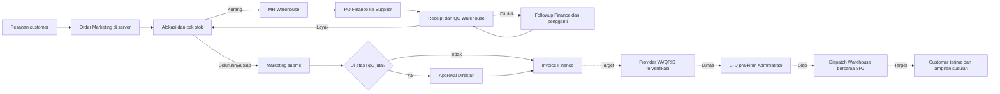

# Arsitektur aplikasi dan batas integrasi

Baseline 20 November 2026. Sistem aktif adalah **Laravel + Inertia + Vue dengan API transaksi**, bukan dua aplikasi SPA Vue Router/Pinia yang terpisah. Sumber: [composer.json](../backend/composer.json), [package.json](../frontend/package.json), [route halaman](../backend/routes/web.php), [pages.php](../backend/config/pages.php), [route API](../backend/routes/api.php).

## Lapisan aktif

| Lapisan | Tanggung jawab dan batas |
| --- | --- |
| Laravel web/Inertia 2 | Route halaman, login/sesi, CSRF, pengiriman komponen Vue; URL Laravel adalah pintu masuk |
| Vue 3 + Vite 6 + Tailwind 4 | UI, form, tampilan status dan navigasi Inertia Link; build ke backend/public/build |
| State browser legacy | Vue reactive/localStorage pada `frontend/src/stores/mockData.js`; sebagian data lokal dan adapter server bercampur, bukan ledger bisnis |
| API/Sanctum | Autentikasi, EnsureApiAccess, validasi request, pembatasan per aksi/objek di controller |
| Service domain | SalesOrderInventory, InventoryTransaction, PurchaseReceiving, StockLedger, SpjProjectFromOrder dan service generator SPJ |
| Database/file | MariaDB operasional; relasi/versi/transaksi/ledger; template, upload asli dan hasil generate terpisah |
| Reverb/Echo | Infrastruktur pembaruan tersedia; keberadaan paket tidak menjamin setiap modul real time atau memakai provider eksternal |

API customer/order/pengadaan/alokasi/receipt adalah sumber server pada modul yang telah diintegrasikan. Jangan membiarkan adapter lokal membuat status lunas/terkirim bila backend belum mendukung. Pada kode saat audit `recordPayment`, `createShipment` dan perubahan status shipment menghentikan aksi belum terhubung; pertahankan kegagalan yang jelas sampai integrasi sah selesai.

## Orkestrasi proses

Garis putus-putus menandai integrasi target yang belum lengkap, bukan proses paralel. Generator SPJ dan invoice sudah mempunyai kode sendiri, tetapi hubungan keseluruhan belum selesai. Nomor resi Supplier→Gudang berada pada modul pengadaan; Warehouse→Customer berada pada target pengiriman customer.

## Konsistensi dan transaksi

Penulis stok/alokasi memakai InventoryTransaction: mutex inventory sebelum row lock entitas, transaksi dan retry deadlock terbatas. Alokasi tidak mengubah fisik; penerimaan accepted dan ledger dicatat atomik. Receipt mempunyai kunci retry dan hash payload. Draft/order/customer menggunakan versi sesuai kontrak endpoint; submit menolak versi usang, sementara approve/invoice memeriksa state terbaru dalam lock.

Perluasan target harus mempertahankan urutan kunci yang sama. Verifikasi provider menyimpan event dedup dan perubahan pembayaran atomik. Finalisasi bundel mengevaluasi sumber sah. Dispatch memeriksa ulang lunas+SPJ Siap dan menyimpan perubahan pengiriman, mutasi stok serta pelepasan alokasi sekali. Pekerjaan email/notifikasi dimulai setelah commit dengan dedup/retry yang tidak membuat transaksi ulang. Nama event/job/tabel belum ditetapkan; jangan mengklaim pola outbox atau worker tertentu sudah berjalan.

## Integrasi target dan keamanan

Satu provider VA/QRIS sandbox mengikuti Sprint 2, belum bank/provider pilihan. Verifikasi signature/identitas harus memakai kontrak provider resmi saat dipilih, bukan rancangan header rekaan. Instruksi pembayaran tidak sama dengan hasil pembayaran; query provider untuk rekonsiliasi hanya server berwenang. Rahasia provider tidak dikirim ke Vue atau log publik.

CAPS-26 menggunakan InvoiceDeliveryService untuk mencatat percobaan saat pesanan terkunci. Dalam mode demo dengan penerima default aktif, penerbitan dan pencatatan percobaan berlangsung dalam satu transaksi. Setelah commit, InvoiceEmailSender menghubungi Mailtrap. Pengiriman ulang memakai layanan dan tujuan yang sama. Server membentuk tautan dari `APP_URL` dan menyimpan hash token. Halaman customer memeriksa invoice, pemilik, masa berlaku, pencabutan dan alamat sesuai kebijakan yang tercatat saat kirim. Pelacakan pengiriman barang melalui tautan customer merupakan cakupan CAPS-32. Supplier tetap dibatasi PO miliknya melalui akun yang terhubung.

Template/upload/file output harus dilayani melalui pemeriksaan akses. Unduh SPJ aktif masih dapat menulis/generate; target pisahkan generate berotorisasi dari pembacaan file versi tersimpan. Master template tidak sama dengan transaksi final. Format asli dipertahankan terpisah, pengambilan gambar jarak jauh dinonaktifkan pada renderer.

## Batas sinkronisasi SPJ

SpjProjectFromOrder menyiapkan proyek/draft dan snapshot order/profil. Ia belum menjadi penghubung otoritatif menyeluruh antara approval order, pembayaran provider dan dispatch. Referensi utama berupa JSON source_order_number; order lain dalam proyek sama belum diakumulasi. Salinan `finance_status`, `warehouse_status` atau `director_approval` tidak boleh dipakai untuk melewati gerbang transaksi. Rancangan final harus membaca sumber sah atau snapshot berversi yang dapat dibuktikan.

## Pengujian dan implementasi bertahap

Gunakan kontrak [API](API.md)/[schema](SCHEMA.md), uji domain/HTTP di SQLite terpisah dan konkurensi di engine tujuan, lalu browser desktop/mobile terhadap Laravel nyata. Fixture dibolehkan selama pengembangan paralel; DoD integrasi pembayaran memerlukan hasil provider sandbox nyata, bukan mock sebagai satu-satunya bukti. Render Word/PDF diperiksa isi dan tampilan. Jangan mengubah desain/navigation sekaligus mengerjakan gerbang bisnis di luar issue. Prioritas dan keterbatasan di [audit](BPMN_JIRA_AUDIT.md).
