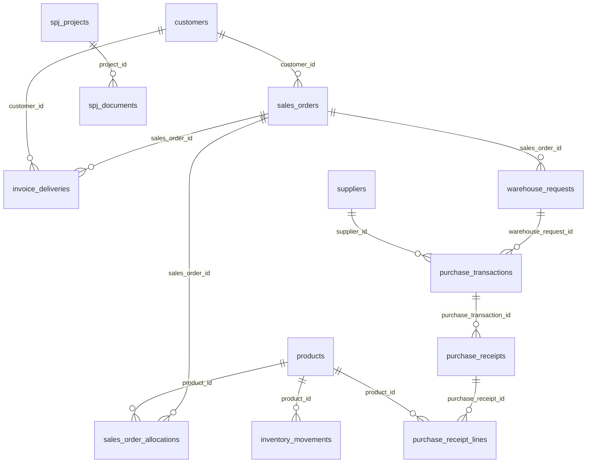

# Database — struktur aktif dan kebutuhan TO-BE

Baseline 20 November 2026. Sumber struktur adalah [migrasi](../backend/database/migrations) dan [model](../backend/app/Models), bukan contoh JSON browser. Dokumen ini tidak menjalankan migrasi. Lingkungan operasional yang diperiksa menggunakan koneksi mysql/MariaDB 10.4 InnoDB; QA memakai SQLite terisolasi. Uji konkurensi juga perlu dilakukan pada engine tujuan, karena SQLite tidak membuktikan seluruh perilaku row lock InnoDB.

## Tabel dan relasi domain aktif

| Tabel | Isi utama dan relasi |
| --- | --- |
| `users` | Akun, role; dipakai pelaku order, approval, receipt dan ledger |
| `customers` | Kode unik, nama/kontak/telepon/alamat, email/city nullable, profile JSON, version, created_by |
| `products`, `product_categories`, `product_units` | SKU unik, satuan/kategori, stok fisik integer, nilai biaya/jual; produk mempunyai soft delete |
| `suppliers` | Kode unik, identitas/kontak/alamat/detail supplier, is_active |
| `sales_orders` | Nomor unik, customer_id nullable untuk legacy, created_by, status/version, details/items/history JSON, subtotal/tax/grand_total rupiah integer, submitted/approved actor+time, approval_notes, invoice JSON nullable |
| `sales_order_allocations` | sales_order_id + product_id + qty; unik gabungan order/produk; tidak mengurangi stock fisik |
| `invoice_deliveries` | Satu percobaan email per baris, terkait sales order, customer, nomor invoice dan pengguna Finance. Menyimpan penerima, status, waktu, hash SHA-256 token yang unik, kedaluwarsa dan pencabutan. |
| `warehouse_requests` | request_code unik, tanggal, sales_order_id, requested_by_id, order_items_hash, items JSON, total_est_cost decimal(15,2), status, purchase_code nullable, procurement_draft JSON nullable |
| `purchase_transactions` | purchase_code unik, MR ID/kode, supplier_id, snapshot default_supplier, tanggal/faktur, items JSON, subtotal/discount/total_price decimal(15,2), status, pending_followup, supplier_progress/history JSON, progress_version |
| `purchase_receipts` | purchase_transaction_id, UUID retry dan hash payload, tanggal, received_by_id, notes, legacy |
| `purchase_receipt_lines` | receipt ID, product ID, line_index, snapshot SKU/nama/satuan, accepted_qty/rejected_qty, reason |
| `inventory_locks` | Baris mutex inventory ID 1 untuk urutan transaksi stok/alokasi |
| `inventory_movements` | product_id/actor_id, type, reference_type/id, delta, before_stock/after_stock, snapshot SKU/nama, reason, timestamps |
| `spj_projects` | project_id string unik, identitas/profil proyek, nilai invoice/payment salinan, status lama, items/metadata/director_approval/warehouse_data/finance_data JSON |
| `spj_documents` | FK project_id string, doc_key/doc_order, status, requirements, nomor/tanggal, form_data, file_path, source_file_path, version |
| `document_templates`, `order_documents` | Master dokumen dan hasil dokumen order; terpisah dari tabel SPJ |
| `regions` | Referensi wilayah |

Tabel framework seperti token Sanctum, session/cache/job tetap ada sesuai migrasi. Daftar domain ini bukan klaim hanya ada sejumlah tertentu tabel pada seluruh database. Ledger dan alokasi tidak memiliki model Eloquent untuk setiap tabel; sumber otoritas tetap migrasi/service.

Garis ERD menggambarkan relasi referensi/logis; jangan menyimpulkan semuanya memiliki foreign key atau kardinalitas unik yang ditegakkan database. Contohnya `purchase_transactions.warehouse_request_id` pada migrasi awal adalah unsigned bigint nullable, bukan FK/unique; service membatasi satu PO per MR dalam transaksi. `sales_orders.details.projectId`/`spj_projects.metadata.source_order_number` adalah referensi JSON, bukan FK formal. Order legacy boleh belum punya customer_id. Perbaikan constraint perlu migrasi terpisah setelah audit data.

## Integritas yang sudah terlihat pada struktur

- Nomor order/MR/PO/customer/supplier unik. Alokasi unik `(sales_order_id, product_id)`.
- Receipt unik `(purchase_transaction_id, idempotency_key)` dan baris receipt unik `(purchase_receipt_id, line_index)`; payload_hash membedakan retry identik dari konflik.
- Dokumen SPJ unik `(project_id, doc_key)`; project_id mengacu kunci string proyek. Source upload terpisah dari hasil generate sejak migrasi preservasi upload.
- Ledger mempunyai index `(product_id,id)` dan `(type,id)` untuk histori. Referensi transaksi dicatat bersama delta dan stok sebelum/sesudah; ledger pembukaan migrasi tidak menambah stok fisik lagi.
- Relasi customer/order dan produk/receipt membatasi penghapusan sesuai migrasi. Arsip barang menjaga referensi historis; data legacy tidak dipadankan berdasarkan kemiripan nama.

## Risiko struktur aktif yang harus diatasi dalam backlog

Migrasi awal PO mempunyai default `LUNAS`, meskipun controller baru secara eksplisit menyimpan `DIPESAN`. Migrasi awal proyek SPJ juga memberi default `DISETUJUI`, `TERKIRIM`, `LUNAS`; jalur `SpjProjectFromOrder` baru menimpa menjadi Draft/Pending/Menunggu Pembayaran. Default lama tetap tidak boleh menjadi bukti bisnis. Nilai `invoice_paid`/finance_status pada proyek bukan ledger pembayaran provider.

Approval order dan `spj_projects.director_approval` terpisah; sinkronisasi otomatis approval/pembayaran/pengiriman menyeluruh belum tersedia. Proyek yang menerima order kedua dengan instansi sama belum mengagregasi nilai/barang kedua secara otomatis; jangan menyebut total proyek sebagai rekap multi-order yang terjamin. Keputusan agregasi harus jelas sebelum SPJ memakai banyak order.

## Kebutuhan penyimpanan target Sprint 2 — belum migrasi aktif

| Kapabilitas | Data/constraint yang diperlukan; penamaan tabel masih rancangan |
| --- | --- |
| Pembayaran invoice | Referensi order/invoice tunggal dan nilai/mata uang immutable, status pembayaran sah terpisah dari status order/dokumen |
| Percobaan VA/QRIS | Satu invoice dapat mempunyai beberapa attempt; provider reference unik, kanal, amount, expiry dan state; tidak membuat invoice baru |
| Notifikasi provider | Event/reference unik, hasil autentikasi, hash payload, waktu diterima/provider, keputusan pemrosesan; kebijakan penyimpanan payload sensitif ditentukan |
| Email konfirmasi pelunasan | Referensi ke pembayaran terverifikasi dan deduplikasi pengiriman konfirmasi CAPS-29 |
| Kesiapan SPJ | Checklist pra-kirim versi yang ditetapkan, validasi sumber, actor/waktu dan bundel/versi file; checklist susulan tersendiri |
| Dispatch/penerimaan customer | Referensi order/SPJ/payment, kurir/resi/actor/time, kunci aksi unik dan peristiwa stok; konfirmasi terima idempoten setelah dispatch |

Belum ada tabel pembayaran/provider webhook atau shipment customer pada migrasi yang diperiksa. Jangan menjalankan SQL dari rancangan ini sebagai skema final. Sebelum menambah migrasi, putuskan provider, satuan nilai uang, daftar SPJ pra-kirim dan cakupan satu/multi-order; petakan state legacy, backfill tanpa mengarang lunas/terkirim, tambah constraint setelah membersihkan data, lalu uji migration/rollback pada salinan. Jangan mengubah migrasi historis untuk diam-diam menafsir ulang transaksi lama.

## Perlindungan operasi

Backup database dan file terkait sebelum migrasi operasional; review rencana backfill/rollback terlebih dahulu. Tidak menjalankan seeder contoh atau `migrate:fresh` pada data pengguna. Uji menggunakan database/file output terisolasi. Arsip, histori dan referensi dokumen yang sudah ikut pengiriman harus dipertahankan meskipun ada revisi master. Detail bentuk data dan transisi di [SCHEMA.md](SCHEMA.md).
