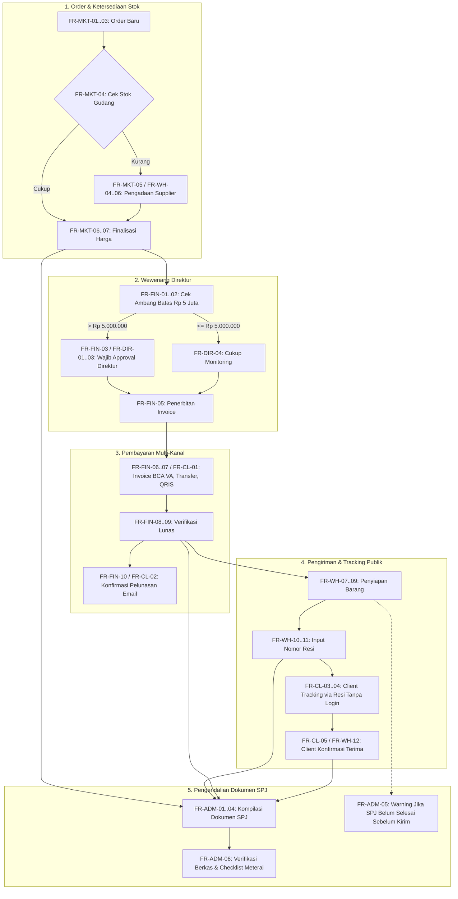

# Product Requirements Document (PRD)
## Sistem Manajemen Pengadaan & SPJ Terintegrasi — CV. Alphate Artha Jaya

| Parameter | Spesifikasi |
| :--- | :--- |
| **Nama Produk** | AlphaSPJ Platform (Integrated Procurement & SPJ System) |
| **Organisasi** | CV. Alphate Artha Jaya (CV. Alpharo Artha Jaya) |
| **Versi Dokumen** | 1.1.0 (Formal FR Baseline) |
| **Stack Backend** | Laravel 12.x (PHP 8.4) & Sanctum Auth |
| **Stack Frontend** | Vue 3.5 (Composition API `<script setup>`), Vite 6, Tailwind CSS v4, Lucide Icons |
| **Dasar Analisis** | Diagram BPMN To-Be: Proses Pesanan Hingga Dokumen SPJ |

---

## 1. Latar Belakang & Masalah Bisnis

1. **Pemisahan Wewenang (Segregation of Duties - SoD)**:
   Pencatatan pembelian barang sering tumpang-tindih antara staf Gudang dan Finance. Gudang tidak berwenang mengelola komitmen uang atau harga beli, dan Finance tidak boleh memanipulasi stok fisik tanpa verifikasi penerimaan barang yang sah.
2. **Katalog Master 2.196 SKU Bahan Baku**:
   Pengadaan barang sering mengalami kekeliruan penamaan, ketidakseragaman konversi satuan, atau salah estimasi harga jika diinput manual. Sistem mewajibkan pemilihan item langsung dari master 2.196 SKU dengan satuan terkunci otomatis.
3. **Penyusunan Dokumen SPJ yang Memakan Waktu**:
   Pengumpulan berkas cetak (Surat Pesanan, Faktur Pembelian Supplier, Surat Jalan, Invoice, Kuitansi, dan BAST) membutuhkan waktu berminggu-minggu. Sistem mengotomasi kompilasi berkas proyek menjadi bundel SPJ siap audit.

---

## 2. Matriks Peran Pengguna (Role Matrix)

| Role | Tanggung Jawab Utama | Akses Menu di Sistem |
| :--- | :--- | :--- |
| **Marketing** | Manajemen data klien, pencatatan pesanan (sales order), pengecekan stok, pengajuan pengadaan, penerbitan surat jalan. | `/marketing/orders`, `/marketing/clients`, `/marketing/order-form` |
| **Warehouse (Gudang)** | Katalog 2.196 SKU, import/export Excel, pengecekan stok, pengajuan material request, penerimaan barang & QC, pencatatan resi pengiriman. | `/warehouse/products`, `/warehouse/requests`, `/warehouse/fulfillment`, `/warehouse/shipments` |
| **Finance (Keuangan)** | Verifikasi pengajuan, filter approval Direktur >Rp 5 Juta, pembuatan invoice (BCA VA, Transfer, QRIS), pencatatan pelunasan & konfirmasi email. | `/finance/purchases`, `/finance/purchases/create`, `/finance/invoices`, `/finance/payments` |
| **Administrasi** | Verifikasi kelengkapan berkas, pembuatan dokumen SPJ, peringatan SPJ sebelum kirim barang, checklist meterai, pengarsipan. | `/administration/spj`, `/administration/templates`, `/administration/documents` |
| **Direktur** | Wewenang persetujuan pesanan >Rp 5.000.000, monitoring pesanan $\le$Rp 5.000.000, evaluasi margin & laporan analitik eksekutif. | `/director/dashboard`, `/director/verification`, `/director/reports` |
| **Client (Tanpa Akun)** | Menerima invoice & kuitansi email, tracking pengiriman via nomor resi publik (tanpa login), dan konfirmasi penerimaan barang. | `/tracking/:resi` (Portal Publik) |

---

## 3. Katalog Kebutuhan Fungsional Resmi (Functional Requirements)

Berikut adalah daftar lengkap 46 kebutuhan fungsional resmi sistem yang diselaraskan dengan implementasi modul dan alur BPMN To-Be:

### A. Functional Requirement — Marketing
| ID FR | User | Functional Requirement | Modul / Halaman Sistem |
| :--- | :--- | :--- | :--- |
| **FR-MKT-01** | Marketing | Sistem menyediakan fitur untuk menginput dan mengelola data client. | `/marketing/clients` & `ClientFormView.vue` |
| **FR-MKT-02** | Marketing | Sistem menyediakan fitur untuk membuat pesanan baru berdasarkan data client. | `/marketing/orders/create` & `OrderFormView.vue` |
| **FR-MKT-03** | Marketing | Sistem menyediakan fitur untuk menginput detail pesanan, meliputi barang, jumlah, dan informasi kebutuhan client. | `OrderFormView.vue` (Item Table) |
| **FR-MKT-04** | Marketing | Sistem menyediakan fitur untuk memeriksa ketersediaan stok barang di warehouse. | `OrderFormView.vue` & `WarehouseProducts.vue` |
| **FR-MKT-05** | Marketing | Sistem menyediakan fitur untuk mengajukan permintaan pengadaan barang kepada warehouse apabila stok tidak tersedia atau tidak mencukupi. | Hand-off Marketing ke `/warehouse/requests` |
| **FR-MKT-06** | Marketing | Sistem menyediakan fitur untuk menginput dan memperbarui harga final pesanan setelah dikonfirmasi. | `OrderFormView.vue` (Final Price Confirmation) |
| **FR-MKT-07** | Marketing | Sistem menyediakan fitur untuk meneruskan detail pesanan dan harga final kepada finance. | Order Submission Pipeline $\rightarrow$ Finance Queue |
| **FR-MKT-08** | Marketing | Sistem menampilkan status pesanan untuk membantu marketing memantau perkembangan pesanan. | `/marketing/orders` & `/marketing/orders/monitoring` |

### B. Functional Requirement — Finance
| ID FR | User | Functional Requirement | Modul / Halaman Sistem |
| :--- | :--- | :--- | :--- |
| **FR-FIN-01** | Finance | Sistem menampilkan detail pesanan dan harga final yang telah diteruskan oleh marketing. | `/finance/invoices` & `/finance/purchases/create` |
| **FR-FIN-02** | Finance | Sistem mengidentifikasi pesanan dengan nilai di atas Rp5.000.000 yang memerlukan persetujuan direktur. | Aturan Ambang Batas Otomatis (> Rp 5.000.000) |
| **FR-FIN-03** | Finance | Sistem menyediakan fitur untuk mengajukan persetujuan direktur terhadap pesanan yang memenuhi ketentuan. | Tombol "Ajukan Approval Direktur" pada Order |
| **FR-FIN-04** | Finance | Sistem menampilkan status persetujuan direktur terhadap pesanan yang diajukan. | Badge Status Approval (`PENDING`, `APPROVED`, `REJECTED`) |
| **FR-FIN-05** | Finance | Sistem menyediakan fitur untuk membuat invoice berdasarkan detail pesanan yang telah memenuhi persyaratan persetujuan. | Form Penerbitan Invoice Resmi (`/finance/invoices`) |
| **FR-FIN-06** | Finance | Sistem menyediakan pilihan metode pembayaran berupa BCA Virtual Account (VA), transfer BCA, dan QRIS. | Opsi Pembayaran Invoice: `BCA_VA`, `TRANSFER_BCA`, `QRIS` |
| **FR-FIN-07** | Finance | Sistem menyediakan fitur untuk mengirimkan invoice dan informasi pembayaran kepada client. | Notifikasi Pengiriman Invoice (Email / PDF Link) |
| **FR-FIN-08** | Finance | Sistem menyediakan fitur untuk mencatat dan memverifikasi pembayaran client. | `/finance/payments` (Verifikasi Bukti Bayar) |
| **FR-FIN-09** | Finance | Sistem memperbarui status pembayaran menjadi lunas setelah pelunasan terverifikasi. | Status Update Otomatis $\rightarrow$ `LUNAS` |
| **FR-FIN-10** | Finance | Sistem mengirimkan konfirmasi pelunasan kepada client melalui email. | Automated Email Notification Engine |
| **FR-FIN-11** | Finance | Sistem menyediakan fitur untuk melihat riwayat transaksi dan status pembayaran setiap pesanan. | `/finance/purchases` & `/finance/monitoring` |

### C. Functional Requirement — Warehouse
| ID FR | User | Functional Requirement | Modul / Halaman Sistem |
| :--- | :--- | :--- | :--- |
| **FR-WH-01** | Warehouse | Sistem menyediakan fitur untuk menginput dan mengelola data barang. | `/warehouse/products` (2.196 SKU) |
| **FR-WH-02** | Warehouse | Sistem menyediakan fitur untuk memperbarui jumlah stok barang. | `/warehouse/inventory` & Form Koreksi/Mutasi |
| **FR-WH-03** | Warehouse | Sistem menampilkan detail barang dan jumlah kebutuhan berdasarkan pesanan. | `/warehouse/requests` & Modal Rincian Order |
| **FR-WH-04** | Warehouse | Sistem menampilkan permintaan pengadaan barang yang diajukan oleh marketing. | Antrean Pengadaan Masuk dari Marketing |
| **FR-WH-05** | Warehouse | Sistem menyediakan fitur untuk mencatat permintaan pengadaan barang kepada supplier. | Form *Material Request* (`REQ-YYYY-XXX`) |
| **FR-WH-06** | Warehouse | Sistem menyediakan fitur untuk memperbarui status pengadaan barang berdasarkan informasi dari supplier. | Status Transisi Pengadaan Gudang |
| **FR-WH-07** | Warehouse | Sistem memberikan notifikasi kepada warehouse ketika pesanan telah memenuhi persyaratan untuk diproses. | Notifikasi Barang Siap Diproses / Disiapkan |
| **FR-WH-08** | Warehouse | Sistem menampilkan daftar pesanan yang perlu disiapkan dan dikirim. | `/warehouse/fulfillment` & `/warehouse/shipments` |
| **FR-WH-09** | Warehouse | Sistem menyediakan fitur untuk memperbarui status persiapan barang. | Status: `MENUNGGU_PERSIAPAN` $\rightarrow$ `SIAP_KIRIM` |
| **FR-WH-10** | Warehouse | Sistem menyediakan fitur untuk mencatat nomor resi dan informasi pengiriman barang. | Input Nomor Resi & Ekspedisi Pengiriman |
| **FR-WH-11** | Warehouse | Sistem menyediakan fitur untuk memperbarui status pengiriman berdasarkan informasi yang tersedia. | Status: `SEDANG_DIKIRIM` $\rightarrow$ `TERKIRIM` |
| **FR-WH-12** | Warehouse | Sistem menampilkan status konfirmasi penerimaan barang oleh client. | Indikator BAST / Status Diterima Client |

### D. Functional Requirement — Admin
| ID FR | User | Functional Requirement | Modul / Halaman Sistem |
| :--- | :--- | :--- | :--- |
| **FR-ADM-01** | Admin | Sistem menampilkan detail pesanan yang memerlukan dokumen SPJ. | `/administration/spj` (Antrean Proyek SPJ) |
| **FR-ADM-02** | Admin | Sistem menyediakan fitur untuk membuat dokumen SPJ berdasarkan data pesanan. | Generator Bundel Dokumen SPJ |
| **FR-ADM-03** | Admin | Sistem menyediakan fitur untuk mengunggah atau menyimpan dokumen SPJ yang telah dibuat. | Upload Berkas Scan Eksternal & BAST Bertanda Tangan |
| **FR-ADM-04** | Admin | Sistem menyediakan fitur untuk memperbarui status penyelesaian dokumen SPJ. | Status: `DRAFT`, `VERIFIED`, `SELESAI`, `ARCHIVED` |
| **FR-ADM-05** | Admin | Sistem menampilkan informasi apabila dokumen SPJ belum selesai sebelum jadwal pengiriman barang. | **Early Warning Alert Banner** (Peringatan Sebelum Kirim) |
| **FR-ADM-06** | Admin | Sistem menyediakan fitur untuk mencatat kelengkapan dokumen SPJ, termasuk informasi penggunaan meterai apabila diwajibkan. | Checklist 5 Berkas & Flag Kewajiban Meterai |

### E. Functional Requirement — Direktur
| ID FR | User | Functional Requirement | Modul / Halaman Sistem |
| :--- | :--- | :--- | :--- |
| **FR-DIR-01** | Direktur | Sistem menampilkan daftar pesanan dengan nilai di atas Rp5.000.000 yang memerlukan persetujuan direktur. | `/director/verification` (Filter > Rp 5.000.000) |
| **FR-DIR-02** | Direktur | Sistem menyediakan fitur untuk menyetujui atau menolak pesanan yang memerlukan persetujuan. | Tombol Aksi: `Setujui Order` / `Tolak Order` |
| **FR-DIR-03** | Direktur | Sistem mencatat status dan riwayat persetujuan direktur. | Audit Trail Persetujuan Direktur (`director_approval`) |
| **FR-DIR-04** | Direktur | Sistem menyediakan fitur untuk memantau pesanan dengan nilai Rp5.000.000 atau kurang tanpa memerlukan persetujuan direktur. | `/director/orders` (Monitoring Pesanan $\le$ Rp 5 Juta) |

### F. Functional Requirement — Client (Tanpa Akun)
| ID FR | Aktor | Functional Requirement | Modul / Halaman Sistem |
| :--- | :--- | :--- | :--- |
| **FR-CL-01** | Client | Sistem mengirimkan invoice dan informasi pembayaran kepada client melalui media komunikasi yang ditentukan. | Pengiriman Invoice Digital (BCA VA / Transfer / QRIS) |
| **FR-CL-02** | Client | Sistem mengirimkan konfirmasi pelunasan melalui email setelah pembayaran terverifikasi. | Email Tanda Terima & Kuitansi Lunas |
| **FR-CL-03** | Client | Sistem menyediakan mekanisme tracking pengiriman tanpa mengharuskan client login ke sistem. | **Portal Publik Pelacakan** (Tanpa Autentikasi Login) |
| **FR-CL-04** | Client | Sistem memungkinkan client melihat status pengiriman menggunakan nomor resi yang telah diberikan. | Input Nomor Resi $\rightarrow$ Tampilan Timeline Pengiriman |
| **FR-CL-05** | Client | Sistem menyediakan mekanisme bagi client untuk mengonfirmasi penerimaan barang. | Tombol Konfirmasi Penerimaan pada Laman Tracking Resi |

---

## 4. Alur Bisnis Lintas Fungsi & Integrasi BPMN

Hubungan timbal-balik antar-kebutuhan fungsional dijabarkan dalam 5 tahapan terpadu:

---

## 5. Ringkasan Fitur Inti (F-01 s/d F-06)

* **F-01 (Katalog & Import Excel)**: Mendukung 2.196 SKU master barang (`A00000001` - `A00002196`), template Excel resmi, dan manajemen kategori/satuan (`FR-WH-01`, `FR-WH-02`).
* **F-02 (Marketing Order & Client)**: Form registrasi pesanan, integrasi data wilayah bertingkat DKI Jakarta, dan kalkulasi nilai proyek (`FR-MKT-01`, `FR-MKT-02`, `FR-MKT-03`).
* **F-03 (Pengecekan Stok & Material Request)**: Picker modal dari katalog 2.196 SKU, satuan terkunci otomatis, estimasi harga pokok, dan pengajuan ke finance (`FR-MKT-04`, `FR-MKT-05`, `FR-WH-03`, `FR-WH-05`).
* **F-04 (Approval Direktur & Pembelian Finance)**: Validasi ambang batas Rp 5.000.000, panel persetujuan Direktur, form transaksi pembelian bergradasi dengan icon putih (`[Q]`, `[+]`, `[X]`, `[Trash2]`), dan diskon bertingkat (`FR-FIN-01` s/d `04`, `FR-DIR-01` s/d `04`).
* **F-05 (Invoice, Resi & Tracking Publik)**: Penerbitan invoice dengan opsi BCA VA, Transfer BCA, QRIS, pencatatan nomor resi ekspedisi, halaman tracking publik tanpa login, dan email konfirmasi lunas (`FR-FIN-05` s/d `10`, `FR-WH-10`, `FR-CL-01` s/d `05`).
* **F-06 (Kompilasi SPJ, Warning Kirim, & Meterai)**: Generator 15 instrumen dokumen SPJ, banner peringatan jika SPJ belum tuntas sebelum tanggal pengiriman, dan pencatatan bukti fisik meterai (`FR-ADM-01` s/d `06`).